# Evidencia visual de tests frontend

Ejecución **PASS**: 2026-10-07T09:35:39.741Z. Chrome 154.0.8037.98; 19 PNG reales capturados desde el navegador.

Aplicación compilada con Vite preview; API, imágenes y único POST completamente simulados. No se envían altas reales.

[Resultado, aserciones, contadores y SHA256 de cada PNG](resultado.json). Las capturas muestran estados de UI; no sustituyen los tests ni certifican WCAG integral.

[Resultados unitarios JUnit](unit-results.xml) y [resumen de cobertura V8](coverage-summary.json) asociados a esta ejecución: 58 tests, 95,83 % de líneas y 90,27 % de ramas.

La edad de caché se simula modificando sus metadatos; la frontera exacta de una hora se prueba con reloj virtual en las unitarias. Las vistas recuperadas pueden ser visualmente iguales: el nuevo GET se acredita en las aserciones.

tests-coverage.png, si está presente, muestra el HTML real generado por una ejecución previa de tests con cobertura. Ejecutar esa suite antes de test:browser para mantenerlo actualizado.

## Capturas y comprobaciones asociadas

### plp-loading.png

4 skeletons; un status; sin controles ficticios; reduced-motion sin animación.

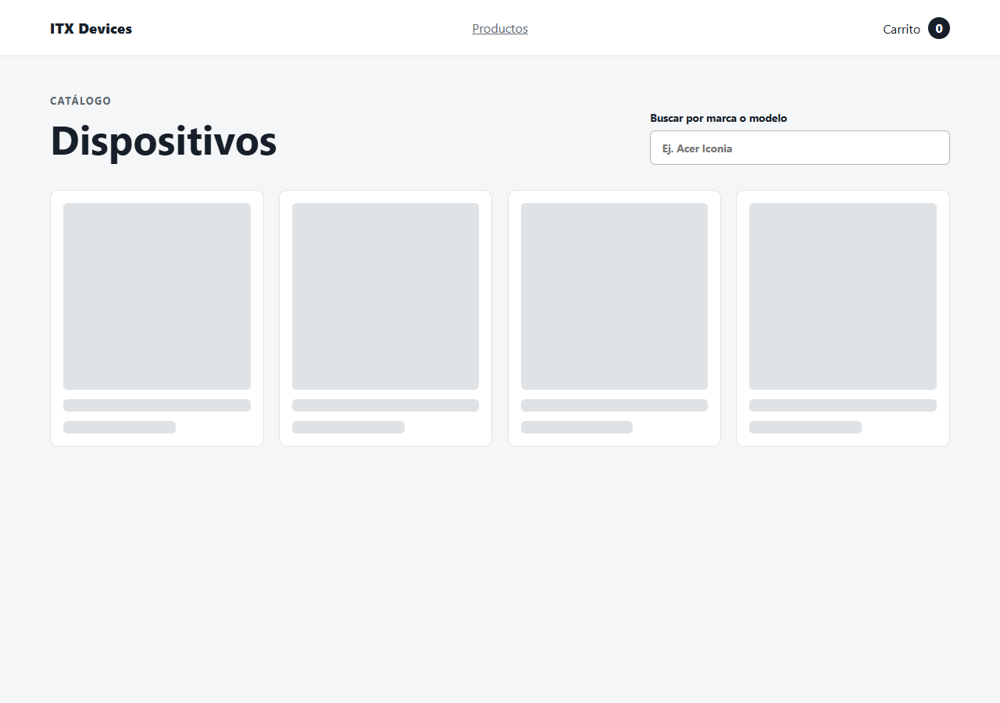

### plp-foco-teclado.png

skip-link activado con teclado; foco en main-content.

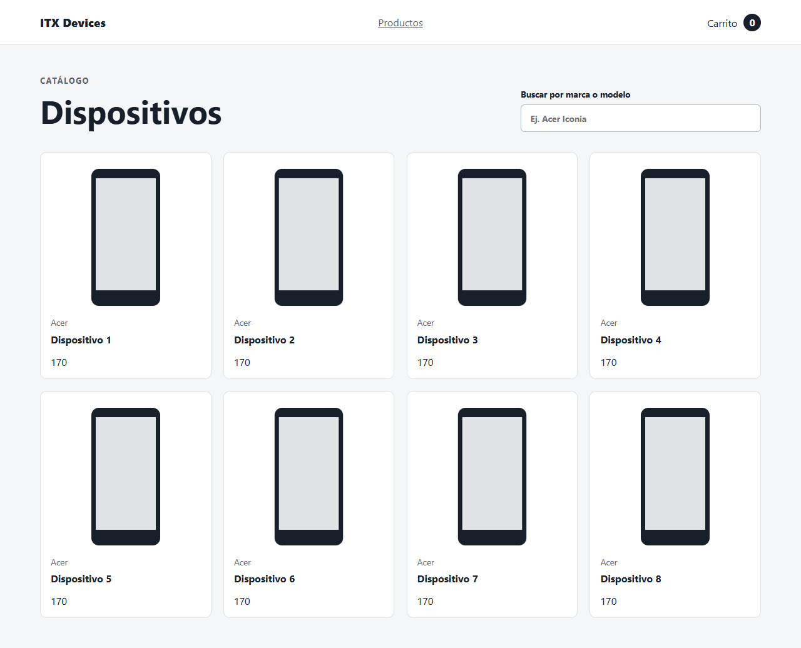

### plp-filtro.png

búsqueda Dispositivo 1: una tarjeta; GET de lista sigue en 1.

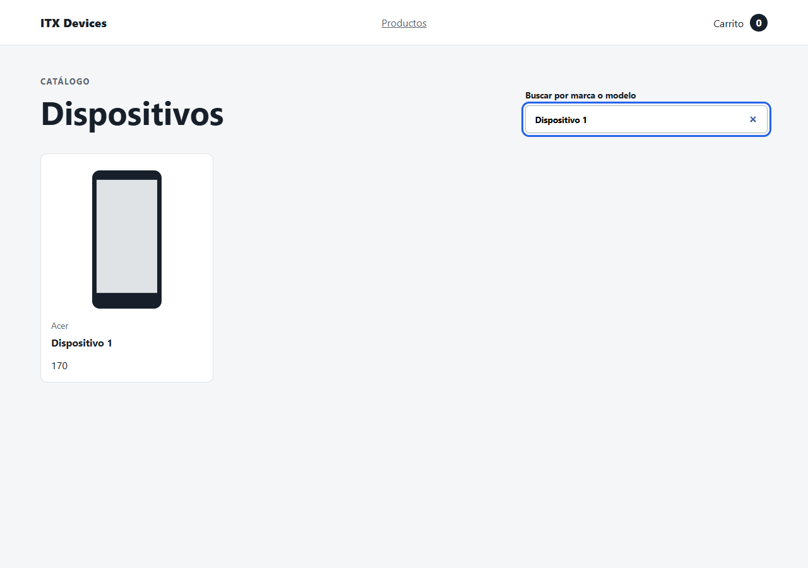

### plp-sin-resultados.png

mensaje de filtro vacío; cero tarjetas; sin GET adicional.

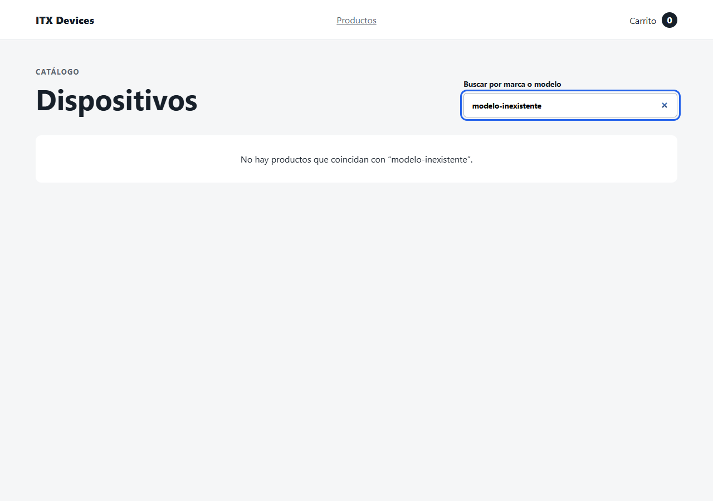

### plp-1280.png

8 productos: 4 columnas; sin overflow horizontal.

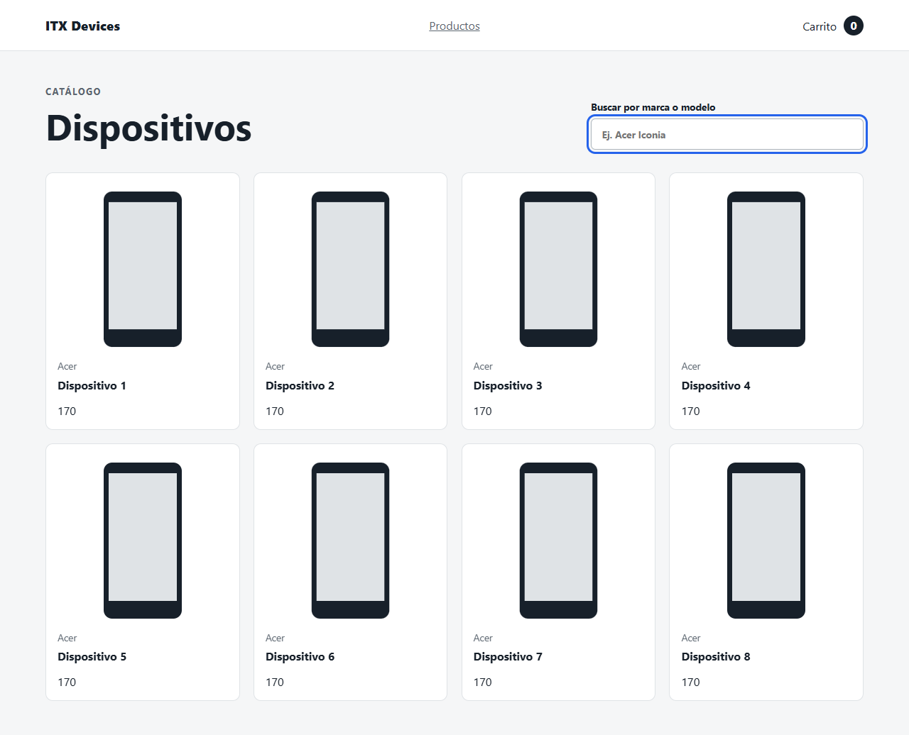

### plp-768.png

8 productos: 3 columnas; sin overflow horizontal.

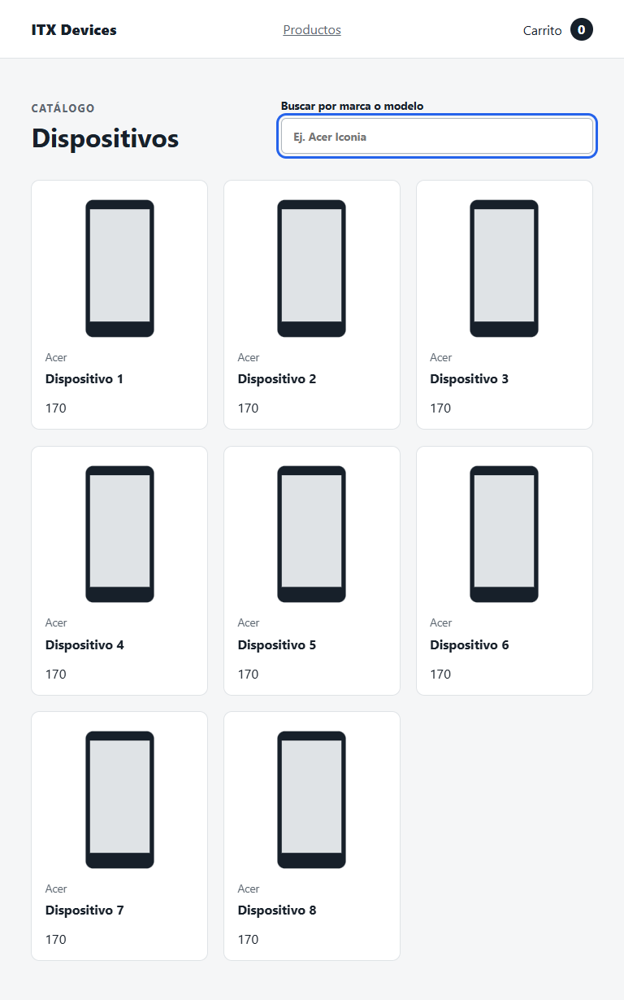

### plp-390.png

8 productos: 1 columnas; sin overflow horizontal.

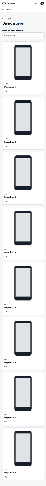

### pdp-loading.png

2 skeletons; un status mientras el detalle sigue pendiente.

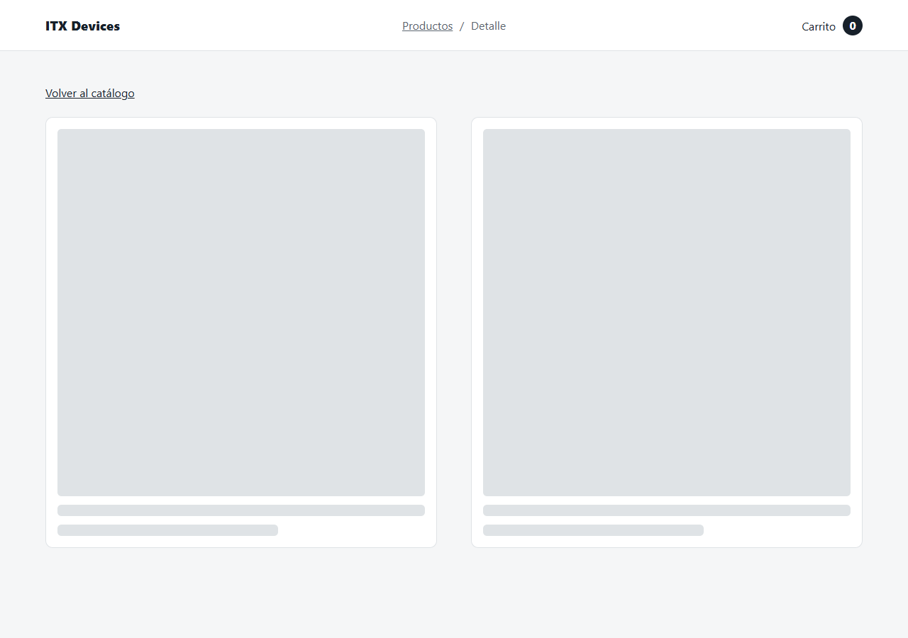

### pdp-seleccion-pendiente.png

submit deshabilitado sin color; unidades de pantalla normalizadas; navegación SPA sin recarga.

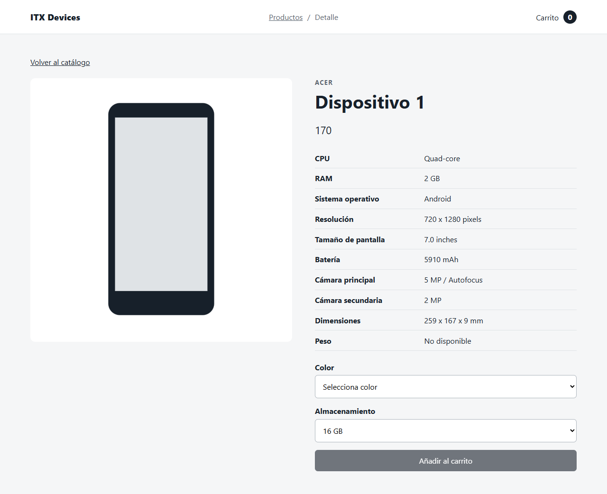

### pdp-1280.png

2 columnas; sin overflow; colorCode=0 seleccionado; storageCode=2000.

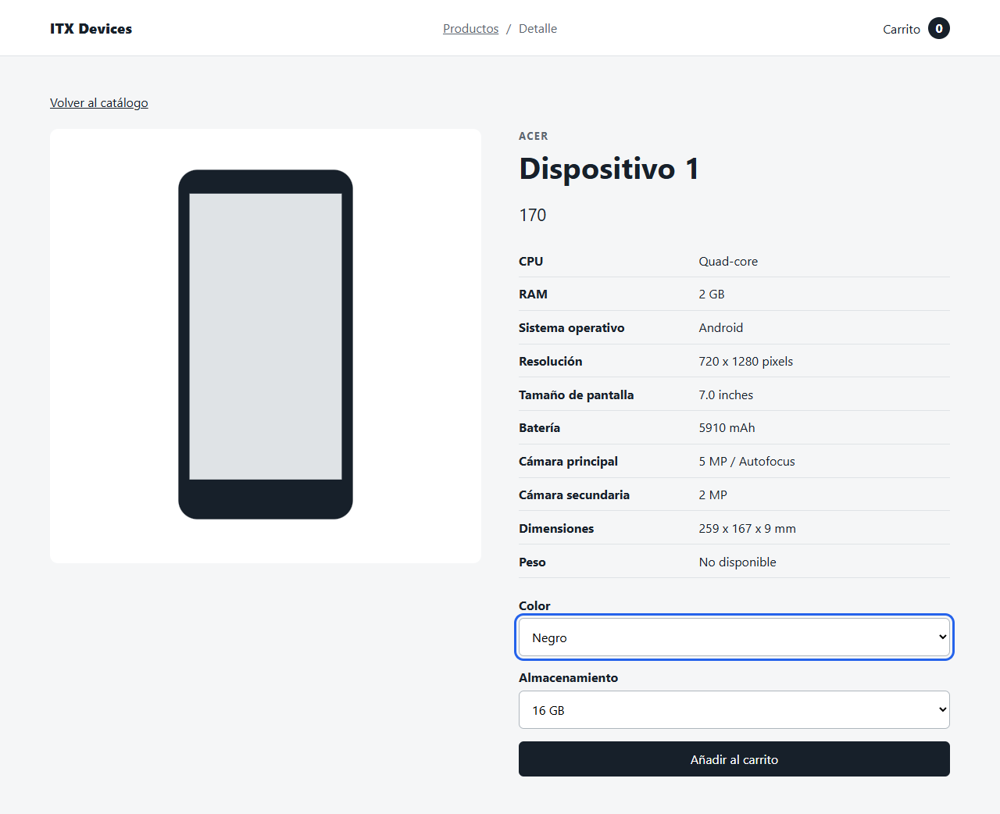

### pdp-768.png

2 columnas; sin overflow; colorCode=0 seleccionado; storageCode=2000.

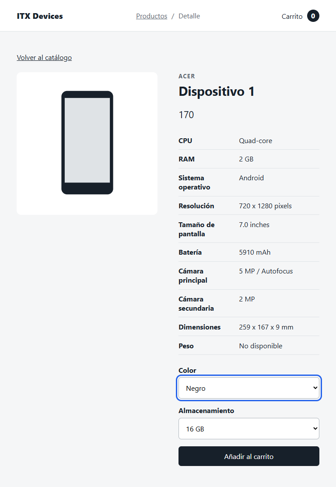

### pdp-390.png

1 columnas; sin overflow; colorCode=0 seleccionado; storageCode=2000.

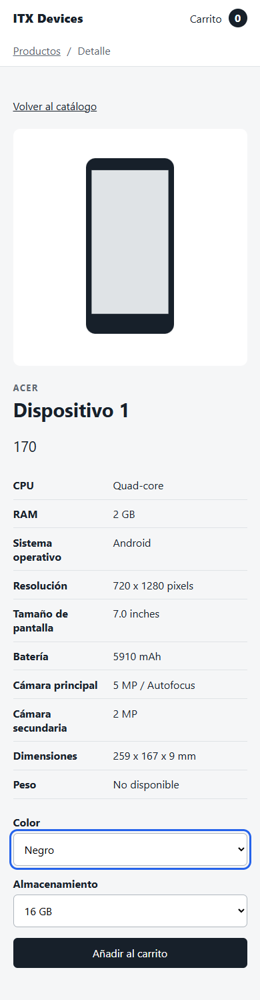

### carrito-confirmado.png

POST simulado único y payload exacto; mensaje de éxito; count confirmado=12.

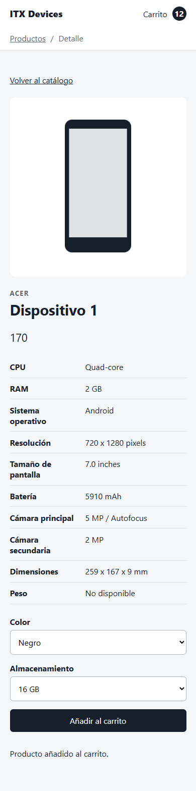

### carrito-persistencia.png

count=12 tras recarga profunda; detalle servido desde caché: GET sigue en 1.

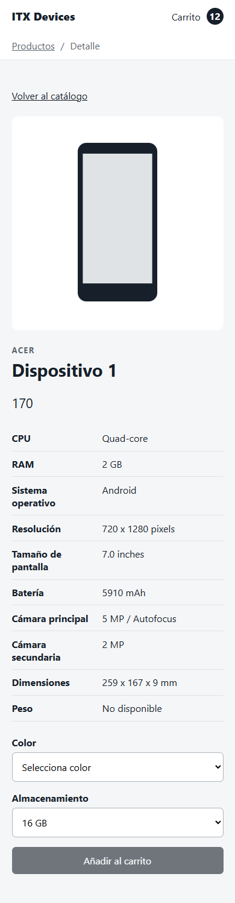

### cache-corrupta-recuperada.png

JSON corrupto invalidado; lista recargada: GET=2; carrito conserva count=12.

### cache-vencida-renovada.png

TTL vencido fuerza GET=3; nueva entrada con TTL absoluto de 3600 s.

### plp-error.png

HTTP500 simulado; alert visible; sin tarjetas stale; reintento disponible.

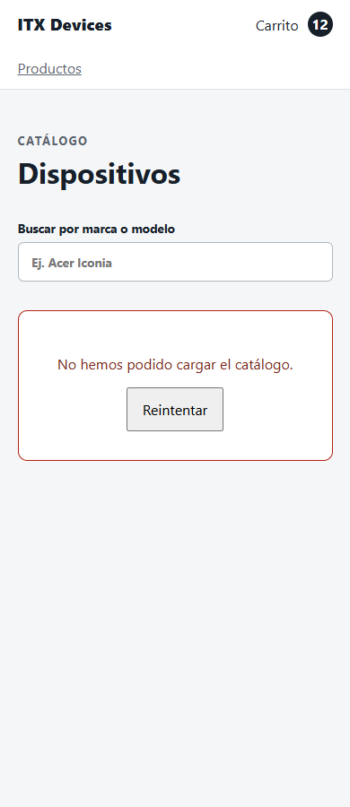

### plp-reintento.png

GET=5 tras reintento explícito; 8 productos restaurados; carrito conserva count=12.

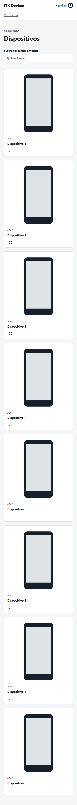

### tests-coverage.png

informe HTML real de cobertura V8; resumen All files.

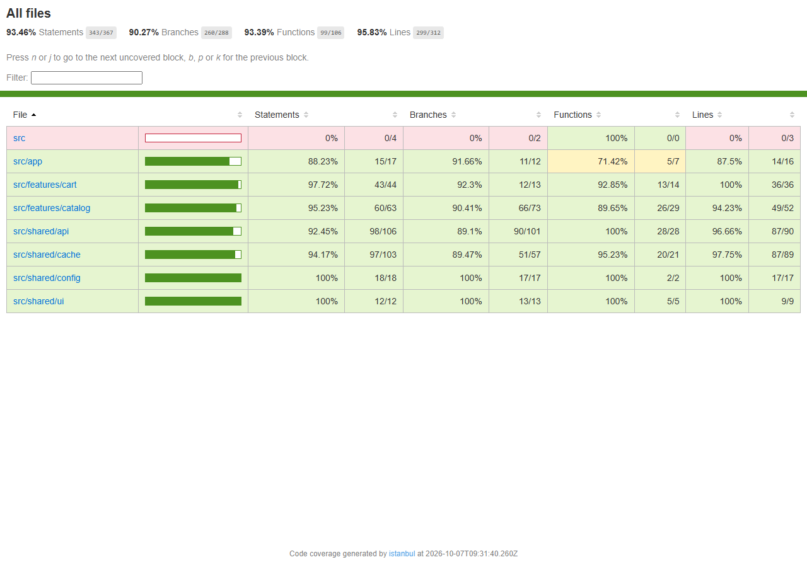
